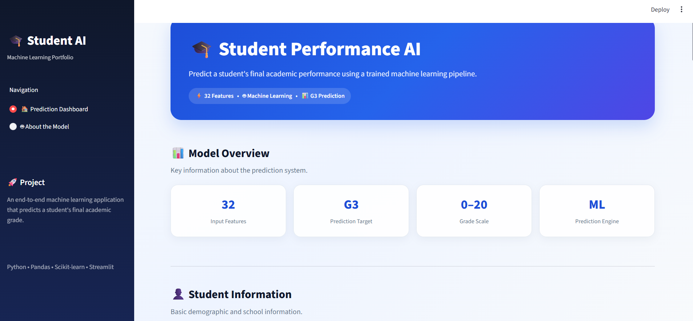
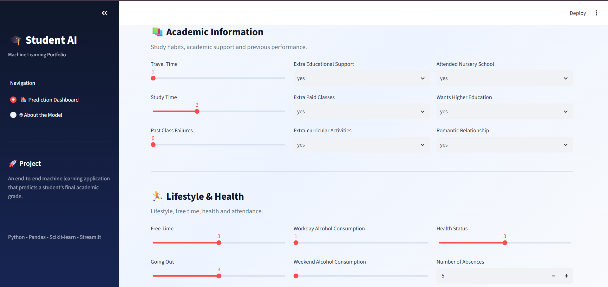
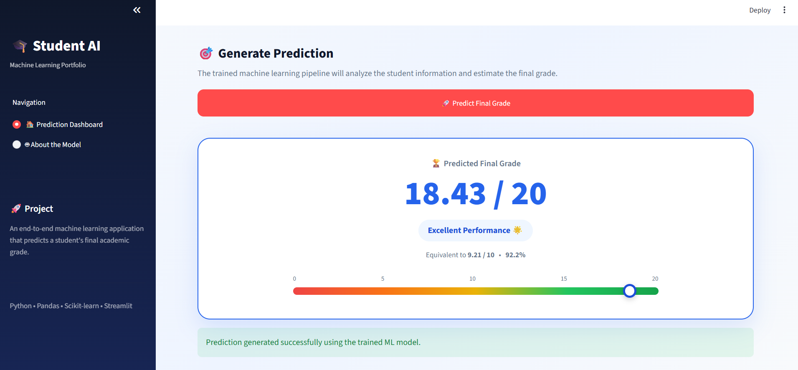
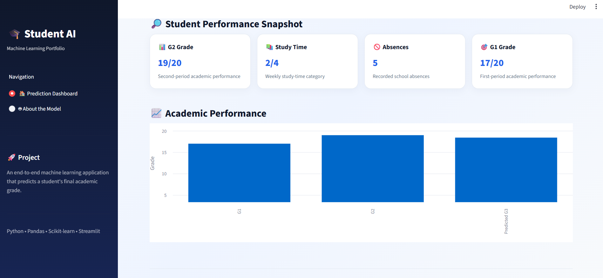
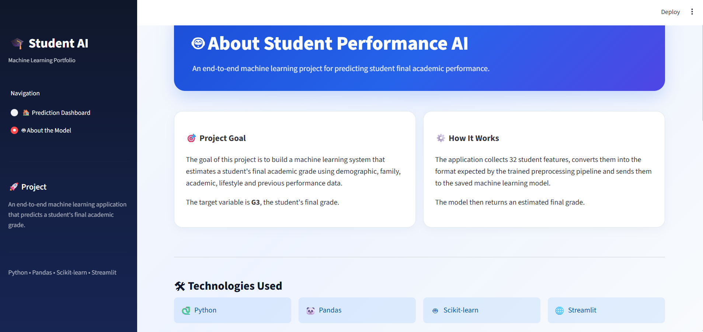
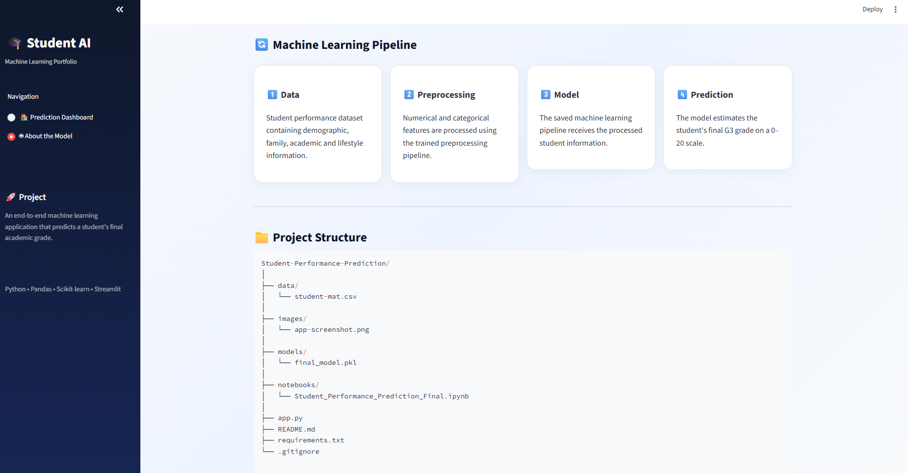

# 🎓 Student Performance Prediction

An end-to-end machine learning project that predicts a student's **final academic grade (G3)** using demographic, family, academic, lifestyle, and previous-performance information.

The project includes data preprocessing, model comparison, evaluation, model selection, and an interactive **Streamlit application** for real-time predictions.

> ⚠️ **Disclaimer:** This is an educational and portfolio project. Predictions are estimates generated by a machine learning model and should not be treated as definitive assessments of a student's future academic performance.

---

## 🚀 Live Demo

🌐 **Student Performance AI:**  
https://student-performance-prediction-qct3uwt5qfre72cxpq9rxg.streamlit.app/

Enter student information and receive an estimated final **G3 grade on a 0–20 scale**.

---

## 🎯 Project Objective

The objective is to build a regression model capable of predicting students' final academic performance.

### Prediction Target

**G3 — Final Grade**

The model uses **32 input features** covering:

- Demographic information
- Family background
- Academic information
- Previous grades
- Study habits
- Lifestyle information
- School support
- Absences

---

# 🧠 Machine Learning Workflow

```text
Student Performance Dataset
          ↓
Exploratory Data Analysis
          ↓
Data Preprocessing
          ↓
Train-Test Split
          ↓
Model Training
          ↓
Model Comparison
          ↓
Model Evaluation
          ↓
Final Model Selection
          ↓
Streamlit Deployment
```

---

## 🔄 Application Workflow

```text
Student Information
        ↓
Data Preprocessing
        ↓
Trained ML Pipeline
        ↓
Random Forest Model
        ↓
G3 Prediction
        ↓
Performance Interpretation
```

### 1. Student Input

The application collects information such as:

- School
- Age
- Gender
- Family information
- Parents' education
- Study time
- Past failures
- Educational support
- Absences
- G1 grade
- G2 grade
- Lifestyle information

### 2. Data Preprocessing

The trained preprocessing pipeline handles numerical and categorical features and transforms them into the format expected by the machine learning model.

### 3. Model Prediction

The processed input is passed to the saved model:

```text
models/final_model.pkl
```

### 4. Performance Output

The application displays:

- Predicted G3 grade out of 20
- Equivalent score out of 10
- Percentage
- Performance category
- Performance gauge
- G1 vs G2 vs predicted G3 comparison

---

# 🤖 Model Development

Multiple regression models were evaluated during the project.

| Model | Purpose |
|---|---|
| Linear Regression | Baseline regression model |
| Decision Tree Regressor | Non-linear regression |
| Tuned Decision Tree | Improved tree-based model |
| Random Forest Regressor | Ensemble regression model |

Random Forest was selected as the final model based on its overall predictive performance.

---

# 📊 Model Performance

### Final Holdout Evaluation

The final Random Forest model achieved:

| Metric | Score |
|---|---:|
| **R²** | **0.8031** |
| **MAE** | **1.2089** |
| **RMSE** | **2.0093** |

### What these metrics mean

**R² = 0.8031**

The model explains approximately 80% of the variation in the target grades on the final holdout test set.

**MAE = 1.2089**

On average, the model's prediction differs from the actual G3 grade by approximately 1.21 grade points.

**RMSE = 2.0093**

RMSE gives greater weight to larger prediction errors and is useful for evaluating the overall prediction error.

---

# 🔬 Cross-Validation

The project also evaluated models using **5-fold cross-validation** to obtain a more robust estimate of model performance.

The Random Forest model achieved approximately:

```text
Mean R²   : 0.890
Std. Dev. : 0.034
Mean MAE  : 0.957
Mean RMSE : 1.499
```

Cross-validation helps evaluate whether model performance is consistent across different subsets of the dataset.

---

# 📈 Example Prediction

For demonstration, the application can produce an output such as:

```text
Predicted G3 = 18.84 / 20
Percentage   = 94.2%
Category     = Excellent Performance
```

> This is an example application prediction and is not the model's evaluation score.

---

# 🖥️ Streamlit Application

The project includes an interactive Streamlit interface designed to make the trained model accessible without directly interacting with the notebook.

## Prediction Dashboard



## Student Information & Inputs



## Prediction Result



## Performance Snapshot



## About the Model



## Machine Learning Pipeline



---

# 🛠️ Tech Stack

| Technology | Purpose |
|---|---|
| **Python** | Programming language |
| **Pandas** | Data manipulation |
| **NumPy** | Numerical operations |
| **Matplotlib** | Data visualization |
| **Seaborn** | Exploratory data analysis |
| **Scikit-learn** | Machine learning |
| **Joblib** | Model serialization |
| **Streamlit** | Web application |

---

# 📁 Project Structure

```text
Student-Performance-Prediction/
│
├── data/
│   └── student-mat.csv
│
├── images/
│   ├── dashboard.png
│   ├── input-form.png
│   ├── prediction-result.png
│   ├── performance-chart.png
│   ├── about-model.png
│   └── ml-pipeline.png
│
├── models/
│   └── final_model.pkl
│
├── notebooks/
│   └── Student_Performance_Prediction_Final.ipynb
│
├── app.py
├── README.md
├── requirements.txt
└── .gitignore
```

---

# 💻 Run Locally

### 1. Clone the repository

```bash
git clone https://github.com/anantrai3127/Student-Performance-Prediction.git
```

### 2. Enter the project directory

```bash
cd Student-Performance-Prediction
```

### 3. Install dependencies

```bash
pip install -r requirements.txt
```

### 4. Run the application

```bash
python -m streamlit run app.py
```

The application will open in your browser.

---

# 📦 Requirements

The required dependencies are listed in:

```text
requirements.txt
```

Main libraries include:

```text
pandas
numpy
scikit-learn
matplotlib
seaborn
streamlit
joblib
```

---

# 📚 Dataset

The project uses the **Student Performance dataset**, containing demographic, social, family, academic, and lifestyle information about students.

The final grade **G3** is used as the prediction target.

The dataset contains:

- **395 students**
- **33 columns**
- **32 input features**
- **1 target variable (G3)**

---

# 🎯 Key Features

- ✅ 32 student input features
- ✅ Numerical and categorical preprocessing
- ✅ Machine learning regression pipeline
- ✅ Multiple model comparison
- ✅ Random Forest regression
- ✅ Holdout evaluation
- ✅ 5-fold cross-validation
- ✅ G3 prediction on a 0–20 scale
- ✅ Percentage and score conversion
- ✅ Performance classification
- ✅ Interactive performance visualization
- ✅ Saved model for reusable predictions
- ✅ Streamlit deployment

---

# 💡 What I Learned

Through this project, I practiced:

- Exploratory data analysis
- Data preprocessing
- Numerical and categorical feature handling
- Regression modeling
- Model comparison
- Model evaluation
- Cross-validation
- Random Forest
- Model serialization
- Building Streamlit applications
- Deploying machine learning models
- Structuring an end-to-end ML project

---

# 🔮 Future Improvements

Possible future improvements include:

- Hyperparameter optimization
- More advanced feature engineering
- Additional regression models
- Improved validation strategies
- Model explainability using SHAP
- Prediction confidence analysis
- More detailed student-performance analytics

---

# 👨‍💻 Author

**Anant Rai**

B.Tech. — Computer Science & Engineering (AI/ML)  
Guru Gobind Singh Indraprastha University (GGSIPU)

### Connect

- 💼 [LinkedIn](https://www.linkedin.com/in/anant-rai-205362447/)
- 🐙 [GitHub](https://github.com/anantrai3127)
- 📧 anantbnz3127@gmail.com

---

## ⭐ Project

If you found this project useful or interesting, consider giving the repository a ⭐ on GitHub.
